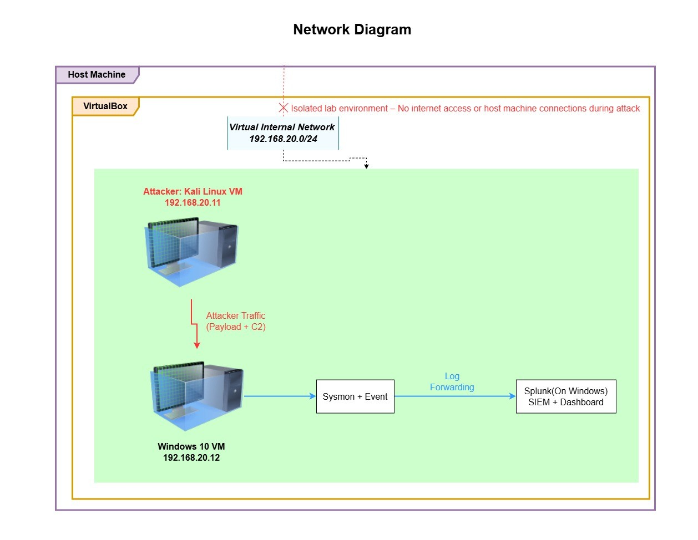

# Cyber Home Lab: Full Attack Simulation (Kali Linux → Windows 10)

A complete home lab demonstrating a realistic attack chain using VirtualBox, Sysmon, and Splunk SIEM.

## Project Overview
- **Hypervision**: VirtualBox
- **Victim**: Windows 10 VM with Sysmon + Splunk Enterprise
- **Attacker**: Kali Linux VM
- **Simulation**: Payload deployment -> successful invasion -> command & control visibility in Splunk

## Lab Architecture
- IP configuration details
- Sysmon configuration (advanced process tracking)
- Splunk dashboard for detection

## Attack Walkthrough
1. Payload creation on Kali
2. Delivery & execution on Windows 10
3. Command execution visibility in Splunk

## Detection & Response
How Splunk detected the attack + sample queries used.

## MD documents
1. cyber-home-lab-attack-simulation/
    README.md

2. logs/

    README.md

3. docs/

    attack-walkthrough.md

    setup-steps.md

4. sysmon/

    README.md

## Topics
`homelab` `cybersecurity` `redteam` `blueteam` `sysmon` `splunk` `virtualbox` `attack-simulation` `siem`, `threat-detection`
